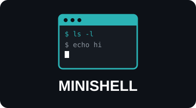
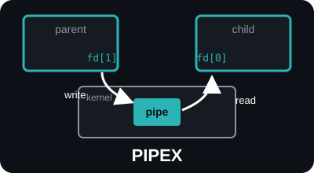
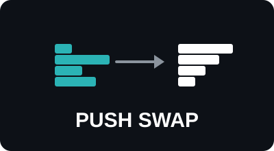
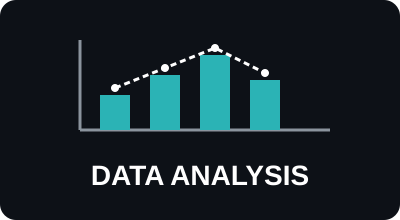

<h1 align="center">Hi, I'm Karla</h1>
<h3 align="center">A mathematician with interest in Criptography and Data Science</h3>

<h3 align="left">Projects:</h3>
<table align="center">
  <tr>
    <td align="center">
      
    </td>
    <td align="center">
      
    </td>
  </tr>
  <tr>
    <td align="center">
      
    </td>
    <td align="center">
      
    </td>
  </tr>
</table>

<h3 align="left">Languages and Tools:</h3>

          

